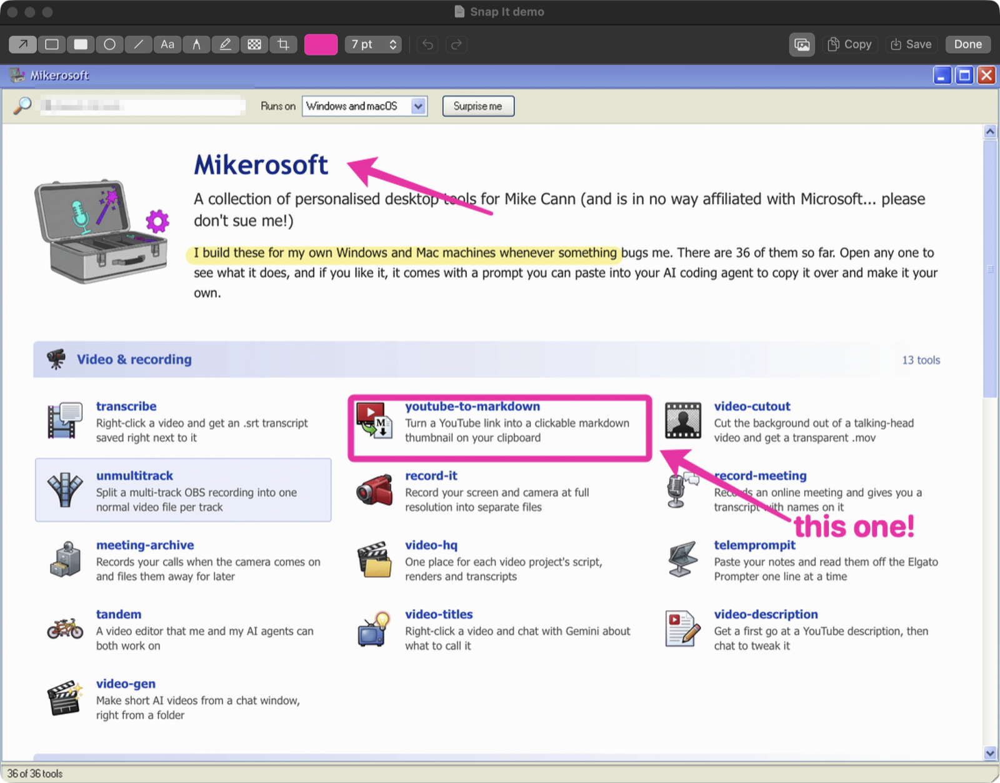
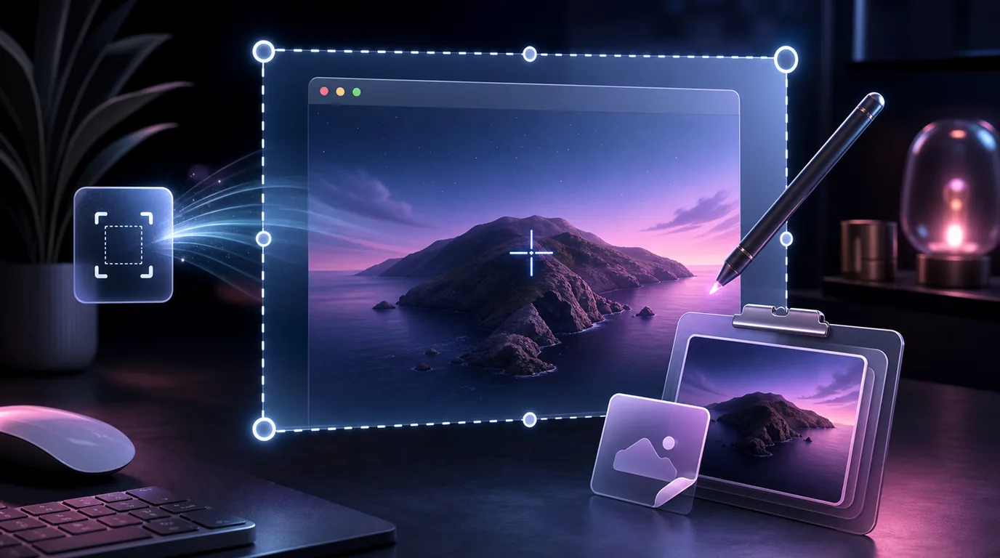

#  snap-it

Press ⌘⇧4, grab part of the screen and start drawing arrows on it straight away

macOS 14 or later

<!-- media: hero -->


[Watch it run (14 seconds)](docs/demo.mp4)
<!-- /media: hero -->

## What it is

My own little replacement for CleanShot X. I was using CleanShot for basically one thing: grab a bit of the screen, slap a pink arrow on it and paste it into a chat. So I made a tool that does just that, and does it fast.

It lives in the menu bar. Press ⌘⇧4, drag out an area and an editor pops up with the arrow tool ready to go. The screenshot is already saved to `~/Screenshots` and on your clipboard, so if you don't want to draw anything you can just paste it.

It's a native Swift app now. The old version was a Python script that opened Preview, which got the job done but wasn't much fun to mark things up in.



## Get it

Paste this into your AI coding agent (Claude Code, Codex, Cursor...):

> Fork https://github.com/mikecann/snap-it to my GitHub account and clone my fork
> (if I don't use GitHub, or want to keep my copy private, just clone it instead),
> then make it my own. It's one of Mike Cann's personal tools, so read the README
> first, change anything specific to his setup to suit mine, then help me get it
> running.

### Or set it up by hand

You'll need macOS 14 or later, Git, and Xcode or the Command Line Tools with Swift 6 or later. Run `xcode-select --install` first if you need them.

```bash
git clone https://github.com/mikecann/snap-it.git
cd snap-it
bash restart.sh
```

That builds it, installs `~/Applications/Snap It.app`, and opens it. It turns on Open at Login the first time it runs. It signs with your first Apple Development identity if you have one (ad-hoc otherwise), so the Screen Recording permission sticks around between rebuilds.

The first time you take a screenshot macOS will ask for **Screen Recording** permission. Turn on Snap It in **System Settings > Privacy & Security > Screen & System Audio Recording**, then try again. No Accessibility permission is needed.

If you were using the old Python version, `restart.sh` stops it and removes its login item for you. If CleanShot X or the built-in macOS shortcuts are still using ⌘⇧3, ⌘⇧4 or ⌘⇧5, turn those off first or Snap It won't get them (the log says if a hotkey couldn't be registered).

`bash uninstall.sh` removes the app and its login item. Your screenshots and the log stay put.

## Using it

- **⌘⇧4** (or **⌘⇧5**): drag out an area. The screen freezes while you pick, with a magnifier for lining things up. Hold Shift for a square. Escape or right-click cancels.
- **⌘⇧3**: the whole screen your mouse is on.

Every capture plays the screenshot sound, saves a PNG like `Screenshot 2026-10-22 at 12.47.51 PM@2x.png`, copies it to the clipboard and opens the editor.

You can also open an existing image in the editor with `open -a "Snap It" some.png`, by dropping it on the app icon, or with Finder's Open With. A PNG gets saved over in place, anything else (JPEG, HEIC, WebP, TIFF) saves as a PNG next to it so the original is left alone.

For Raycast or scripts, `open snapit://capture-area` and `open snapit://capture-fullscreen` do the same as ⌘⇧4 and ⌘⇧3.

In the editor:

| Key | Tool |
|---|---|
| A | Arrow (Shift snaps to 45°) |
| R | Rectangle (Shift for a square) |
| F | Filled rectangle, handy for hiding things |
| O | Ellipse (Shift for a circle) |
| L | Line (Shift snaps to 45°) |
| T | Text, click to type. Double-click text to edit it again |
| P | Pen |
| H | Highlighter (Shift for a straight line) |
| X | Pixelate |
| C | Crop, then Return to apply or Escape to cancel |

Click on anything you've drawn to select it, then drag it around, drag its handles, change its colour or size, or hit Delete. Arrow keys nudge it. ⌘Z and ⌘⇧Z undo and redo.

**Done** (Return or ⌘Return) saves over the PNG, copies it and closes. **Copy** (⌘C) and **Save** (⌘S) keep the window open. The little picture button can be dragged straight into Claude, Slack or Finder. If you close the window with ⌘W or Escape after drawing something, or quit the app, it saves and copies anyway, so you never lose an arrow. If the save fails (disk full, folder gone) the image goes on the clipboard and the window stays open.

## Settings

There's no settings window. It remembers your last tool, colour, thickness and text size. The default is a hot pink arrow at 7 pt, because that's what I use for everything.

To save somewhere else:

```bash
defaults write com.mikerosoft.snap-it saveFolder ~/Desktop/Screenshots
```

Then quit and reopen it from the menu bar.

## Troubleshooting

Check the log:

```bash
tail -f ~/Library/Logs/snap-it.log
```

It says whether each hotkey registered, and how long each capture took.

If nothing happens when you press ⌘⇧4, something else probably has the shortcut. Quit CleanShot X, check **System Settings > Keyboard > Keyboard Shortcuts > Screenshots**, then run `bash restart.sh`.

If you get a black or empty capture, or the permission alert keeps coming back, remove Snap It from the Screen Recording list, add it again and reopen it.

## Development

```bash
swift build
swift test
bash -n restart.sh uninstall.sh
bash restart.sh
```

The tests cover the geometry, file names, shapes, undo/redo, crop and the rendered pixels, so they don't need any screen permissions. After changing the app, run `bash restart.sh` and try a real capture.

## Art

`docs/header.webp` is a generated banner for the public site. `icons/snap-it.png` is `monitor.png` from the [FamFamFam Silk](https://www.famfamfam.com/lab/icons/silk/) set by Mark James, licensed under [CC BY 2.5](https://creativecommons.org/licenses/by/2.5/). That icon retains its original licence.

## More tools

You can find my other tools at [mikerosoft.app](https://mikerosoft.app).

MIT licensed.
